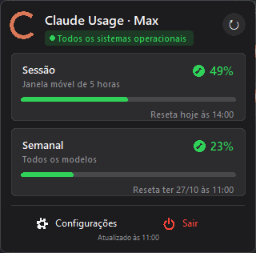
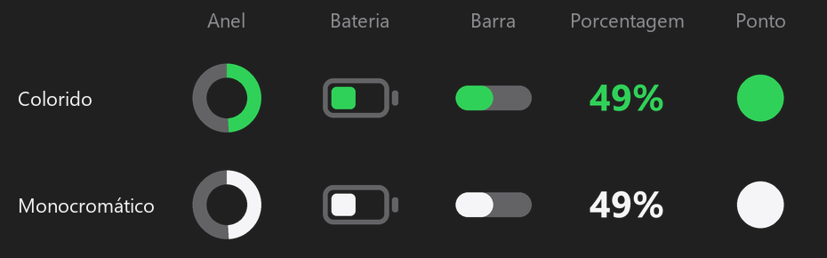
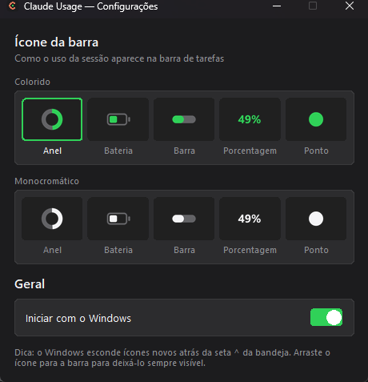

<div align="center">


# Claude Usage Tray

**O uso do seu plano Claude sempre à vista — direto no painel do Ubuntu (e na bandeja do Windows).**

Sessão de 5 horas, limite semanal e status do serviço, junto dos indicadores do sistema, como volume, Wi-Fi e bateria.

[](https://github.com/Guilhermee19/claude-usage-tray/actions/workflows/build.yml)


[](LICENSE)



</div>

---

## Recursos

- **Ícone vivo na bandeja** — mostra a % da sessão atual e atualiza sozinho a cada 2 minutos.
- **Popup no estilo macOS** — cards com a sessão (janela de 5 h), o limite semanal e o limite por modelo
  (quando o plano tem), com barra de progresso e horário exato do reset.
- **Status do serviço** — pílula verde quando todos os sistemas da Anthropic estão operacionais.
- **5 estilos de ícone × 2 cores** — anel, bateria, barra, porcentagem ou ponto; colorido ou monocromático.
- **Inicia com o sistema** — uma chave nas configurações.
- **Seguro com o seu login** — só *lê* o token do Claude Code; nunca o renova, altera ou envia para outro lugar.
- **Leve** — Python puro + [pystray](https://github.com/moses-palmer/pystray) + [Pillow](https://python-pillow.org); ~60 MB de RAM.

<div align="center">

</div>

## Requisitos

- Uma conta Claude **Pro ou Max** logada no [Claude Code](https://docs.claude.com/en/docs/claude-code)
  (o app usa o mesmo login — precisa existir `~/.claude/.credentials.json`).
- **Ubuntu 22.04 ou 24.04** (alvo principal, X11 ou Wayland) — ou outro Linux com bandeja do sistema
  (KDE, XFCE, Cinnamon, MATE, GNOME com AppIndicator) — ou **Windows 10/11**.
- **Python 3.10+** — no Ubuntu já vem instalado. No Windows: `winget install Python.Python.3.12`
  (ou [python.org](https://www.python.org/downloads/), marcando *Add python.exe to PATH*).

## Instalação

### Ubuntu (e outros Linux)

```bash
git clone https://github.com/Guilhermee19/claude-usage-tray.git
cd claude-usage-tray
bash install-linux.sh
```

No Ubuntu o instalador usa o `apt` para instalar o que faltar — `python3-venv`, `python3-tk`, `python3-gi`,
`gir1.2-ayatanaappindicator3-0.1` e `x11-utils` (pede a senha do `sudo` só se precisar). Em seguida cria o
ambiente virtual, adiciona o **Claude Usage** ao menu de aplicativos, pergunta sobre o início automático e
abre o app. Depois disso, use o menu de aplicativos (tecla Super → "Claude Usage") ou `bash start-linux.sh`.

O ícone aparece no **canto superior direito**, junto de rede, volume e bateria, com a % ao lado. Clique nele
para ver o resumo; **Abrir** mostra o popup logo abaixo do painel.

Em outras distros o instalador usa **dnf** (Fedora), **pacman** (Arch) ou **zypper** (openSUSE).

<details>
<summary><b>Problemas comuns no Ubuntu</b></summary>

| Sintoma | Solução |
|---|---|
| `dpkg was interrupted` | uma instalação anterior ficou pela metade: `sudo dpkg --configure -a && sudo apt-get install -f`, depois rode o instalador de novo |
| `faltando: Tkinter, PyGObject/AppIndicator` mesmo após instalar | o `python3` do seu PATH é do pyenv/conda/Homebrew; o instalador já usa `/usr/bin/python3` — confira com `which python3` |
| Ícone não aparece | a extensão **Ubuntu AppIndicators** precisa estar ativa: `gnome-extensions enable ubuntu-appindicators@ubuntu.com` (o instalador tenta ativar). Sem ela: `sudo apt install gnome-shell-extension-appindicator` e saia/entre na sessão |
| Popup não fecha clicando fora | no GNOME janelas sem moldura podem não receber foco — use o **✕** do popup ou **Abrir** de novo no menu |
| Ver erros | `~/.local/state/claude-usage-tray.log` e `~/.config/claude-usage-tray/app.log` |

</details>

> **Fedora, Debian e outros GNOME:** ícones de bandeja precisam da extensão
> [AppIndicator](https://extensions.gnome.org/extension/615/appindicator-support/). No Fedora:
> `sudo dnf install gnome-shell-extension-appindicator`, ative a extensão e reinicie a sessão.

### Windows

```powershell
git clone https://github.com/Guilhermee19/claude-usage-tray.git
cd claude-usage-tray
.\install-windows.bat
```

O instalador cria um ambiente virtual em `.venv`, instala as dependências, adiciona o **Claude Usage**
ao Menu Iniciar, pergunta se deve iniciar junto com o Windows e já abre o app.
Depois disso, use o Menu Iniciar ou `start-windows.bat`.

#### Opcional: gerar um `.exe` na sua máquina

Se quiser um executável único (por exemplo, para levar para outro PC sem Python), gere-o você mesmo
depois de rodar o `install-windows.bat`:

```powershell
.venv\Scripts\pip install -r requirements-dev.txt
.venv\Scripts\python packaging\build.py
```

O arquivo sai em `dist\ClaudeUsage.exe` (~20 MB). Dê dois cliques para abrir; para iniciar com o Windows,
ative a chave nas Configurações do próprio app. A pasta `dist/` está no `.gitignore` — o executável é
para uso local e não deve ser commitado.

> **O ícone não apareceu?** O Windows 11 esconde ícones novos atrás da seta **^** da bandeja.
> Arraste-o para a barra, ou ative em *Configurações → Personalização → Barra de tarefas →
> Outros ícones da bandeja*.

## Uso

| Ação | Ubuntu / Linux | Windows |
|---|---|---|
| Abrir o popup | clique no ícone → **Abrir** | clique esquerdo no ícone |
| Menu rápido | clique no ícone | clique direito |
| Ver os números sem abrir | `8%` ao lado do ícone no painel, ou abra o menu | passe o mouse (tooltip) ou abra o menu |
| Fechar o popup | **✕**, `Esc` ou clicar fora | `Esc` ou clicar fora |

O topo do menu sempre mostra o resumo — `Sessão: 8% — reseta hoje às 19:10` e `Semana: 4% — reseta qui 29/10`.
Depois vêm **Atualizar agora**, **Ícone da barra** (estilo, monocromático e, no Linux, *Mostrar % ao lado do
ícone*), **Configurações…**, **Iniciar com o sistema** e **Sair**. Pelo popup, `Esc` ou clicar fora fecha.

> O texto ao lado do ícone aparece no GNOME, Unity, XFCE, MATE e Cinnamon. O KDE Plasma não exibe esse texto —
> lá, use o estilo **Porcentagem** para ver o número no próprio ícone.

<div align="center">

</div>

### Cores

| | Significado |
|---|---|
| 🟢 Verde | uso da sessão (estilos anel, bateria, barra e porcentagem) |
| 🟡 / 🔴 | no estilo **ponto** e nos cards do popup: ≥ 50% e ≥ 80% |
| ⚪ Cinza | sem dados — sem internet ou token expirado |

### Configuração

As preferências ficam em `config.json`:

| Sistema | Pasta |
|---|---|
| Windows | `%APPDATA%\ClaudeUsageTray\` |
| Linux | `~/.config/claude-usage-tray/` |

```json
{
  "icon_style": "ring",
  "icon_mono": false,
  "panel_label": true,
  "interval_seconds": 120
}
```

`panel_label` (só Linux): mostra a % em texto ao lado do ícone no painel.

`icon_style`: `ring`, `battery`, `bar`, `percent` ou `dot`. Erros vão para `app.log` na mesma pasta.

## Como funciona

```
~/.claude/.credentials.json ──(lê o token)──► api.anthropic.com/api/oauth/usage
                                                 │  five_hour · seven_day · seven_day_opus …
                                                 ▼
                         ícone na bandeja (Pillow) + popup (Tkinter)
```

O app consulta o mesmo endpoint que o comando `/usage` do Claude Code, então os números são idênticos.
O token **não é renovado** pelo app: renovar giraria o *refresh token* e poderia deslogar o Claude Code.
Quando ele expira, o ícone fica cinza com o aviso *"abra o Claude Code"* — basta usar o Claude Code uma vez
e o app volta sozinho na próxima atualização.

> Este endpoint não é uma API pública documentada e pode mudar sem aviso. Se os números pararem de aparecer,
> abra uma [issue](https://github.com/Guilhermee19/claude-usage-tray/issues).

## Desinstalar

```powershell
.\install-windows.bat --uninstall     # Windows
```

```bash
bash install-linux.sh --uninstall     # Linux
```

Remove os atalhos, o início automático e o `.venv`. As preferências ficam na pasta de configuração acima.

## Desenvolvimento

```bash
python -m venv .venv
.venv/bin/pip install -r requirements.txt -r requirements-dev.txt   # Windows: .venv\Scripts\pip
python -m claude_usage_tray                                          # roda com console, vendo erros
python packaging/build.py                                            # gera dist/ClaudeUsage.exe
python packaging/make_icons.py                                       # regera assets/icon.png e icon.ico
```

```
claude_usage_tray/
├── app.py         # orquestra bandeja, polling, popup e configurações
├── usage_api.py   # leitura do token + endpoint de uso + status do serviço
├── tray_icon.py   # desenha os 5 estilos de ícone
├── popup.py       # popup no estilo macOS
├── settings.py    # janela de configurações
├── theme.py       # cores e helpers de desenho
├── system.py      # tudo que é específico de Windows/Linux
└── setup_cli.py   # atalhos de menu/autostart usados pelos instaladores
```

A cada push, o GitHub Actions roda um teste rápido no Windows e no Linux (importa o app e desenha os ícones).

## Licença

[MIT](LICENSE). Projeto independente, sem afiliação com a Anthropic. "Claude" é marca da Anthropic, PBC.
